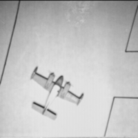
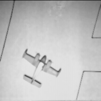
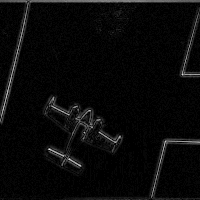
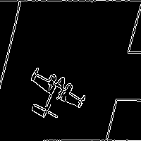
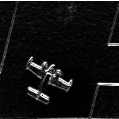

# Лабораторная работа 1. Цифровая фильтрация изображений

## 1. Цель работы

Практическая реализация и анализ методов цифровой фильтрации изображений:
сглаживающих и повышающих резкость фильтров из таблицы 1.1, а также получение
контурных препаратов методами «разность гауссианов» (DoG), детектором границ
Кэнни и оператором Собела для **горизонтальных контуров** (вариант 1, табл. 1.2).
Программа — консольное приложение на C++ с библиотекой OpenCV.

## 2. Краткие теоретические сведения

Цифровая фильтрация состоит в том, что значение пикселя модифицируется с учётом
соседних элементов. Операция сводится к **дискретной свёртке** сигнала с импульсной
реакцией (маской) фильтра. Для двумерного изображения

```
b[k,l] = Σ_m Σ_n h[m,n] · a[k−m, l−n],
```

где `a` — исходное изображение, `h` — маска (апертура), `b` — результат. Размер
апертуры `(2N+1)×(2N+1)` выбирают нечётным, чтобы у маски был центральный элемент
(фокус).

**Линейные фильтры** сохраняют принцип суперпозиции: отклик на сумму сигналов равен
сумме откликов. К ним относятся усредняющие фильтры и фильтр Гаусса (ФНЧ,
сглаживание, подавление шума). **Нелинейные** — медианный фильтр: он сортирует
значения в окне и берёт медиану, подавляя точечные (импульсные) помехи, не
размывая резкие перепады. **Фильтры верхних частот** (апертурная коррекция,
операторы Лапласа/Собела) усиливают перепады яркости — повышают резкость или
выделяют контуры.

Свёртка в сигнальной области эквивалентна перемножению спектров в частотной
(теорема о свёртке): `L{x*h} = X(f)·H(f)`. Это основа двойственности фильтрации.
КИХ-фильтры (трансверсальные) имеют конечную память и всегда устойчивы;
БИХ-фильтры (рекурсивные) — бесконечную память, экономнее по числу операций, но
требуют анализа устойчивости.

## 3. Исходное изображение и фильтрация (таблица 1.1)

Исходное полутоновое изображение (256×256, USC-SIPI, 5.1.11 «самолёт»,
открытая база тестовых изображений):


Все фильтры реализованы вручную через свёртку (без `cv::GaussianBlur`,
`cv::filter2D`). Границы реплицируются. Использованные маски:

| Фильтр | Маска (ядро) / нормировка |
|---|---|
| Гаусса 3×3 | `[[1,4,1],[4,16,4],[1,4,1]]`, k = 36 |
| Гаусса 5×5 | внешнее произведение `[1,4,6,4,1]`, k = 256 |
| Мозаика 3×3 | неперекрывающиеся блоки 3×3 → всем пикселям блока среднее по блоку |
| Апертурная коррекция 3×3 | `[[-1,-1,-1],[-1,13,-1],[-1,-1,-1]]`, k = 5 (S = 20 %, X = 100/S + 8 = 13) |
| Медианный 3×3 | медиана из 9 значений окна |

**Фильтр Гаусса 3×3** — лёгкое сглаживание:



**Фильтр Гаусса 5×5** — более сильное сглаживание (крупная апертура сильнее
размывает детали и шум):


**Фильтр «Мозаика» 3×3** — пикселизация: изображение разбивается на блоки 3×3, всем
элементам блока присваивается среднее по блоку:


**Фильтр апертурной коррекции 3×3** — повышение резкости. Из сигнала фокуса
вычитаются соседние элементы; сумма коэффициентов маски равна `X−8 = 5`, поэтому
ядро сохраняет постоянную составляющую (DC = 1) и не сдвигает яркость. Защита от
переполнения — насыщение результата в `[0, 255]`:


**Медианный фильтр 3×3** — подавление точечных помех с сохранением перепадов:



## 4. Контуры исходного изображения

Контурные препараты получены тремя методами.

**Разность гауссианов (DoG)** — модуль разности откликов фильтров Гаусса 3×3 и 5×5,
умноженный на 7 (с насыщением) для наглядности:



**Детектор границ Кэнни** — готовая реализация OpenCV `cv::Canny(src, 50, 200)`
(сглаживание → градиент → подавление немаксимумов → двойная пороговая фильтрация
→ трассировка):



**Индивидуальный вариант 1 — оператор Собела для горизонтальных контуров.**
Горизонтальный контур — перепад яркости вдоль вертикального направления,
поэтому используется маска вертикального градиента (∂/∂y):

```
Gy = [[-1,-2,-1],[0,0,0],[1,2,1]],   контур = |a * Gy|.
```

Сумма коэффициентов равна нулю → нулевой отклик на ровных участках. Защита от
переполнения — насыщение модуля отклика в `[0, 255]`:



## 5. Выводы

- **Сглаживание.** Фильтр Гаусса 5×5 размывает изображение сильнее, чем 3×3:
  чем больше апертура, тем заметнее подавление высокочастотных составляющих (шума
  и мелких деталей). Мозаика 3×3 даёт эффект пикселизации — структуру изображения
  можно угадать при значительном сокращении числа независимых значений.
- **Повышение резкости.** Апертурная коррекция усиливает перепады яркости; её
  приходится применять осторожно — вместе с контурами усиливается и шум, поэтому
  глубину коррекции S ограничивают 20–30 %. Сохранение DC (нормировка на сумму
  коэффициентов) исключает общее смещение яркости.
- **Медианный фильтр** подавляет импульсные помехи, не размывая границ, в отличие
  от линейного усреднения. Это полезно при точечных выбросах; мелкие детали меньше
  маски всё же удаляются.
- **Контуры.** DoG даёт «толстые» градиентные контуры; детектор Кэнни — тонкие
  (1 пиксель) замкнутые линии с подавлением шума за счёт порогов; оператор Собела
  (вариант 1) выделяет преимущественно горизонтальные перепады, оставляя ровные
  участки чёрными (сумма коэффициентов маски равна нулю). Для горизонтальных
  контуров работает вертикальный градиент (∂/∂y), для вертикальных —
  горизонтальный (∂/∂x).
- Все фильтры таблицы 1.1 и контурные операторы таблицы 1.2 (всего 10 вариантов)
  реализованы в одной программе; переключение варианта — параметром `--variant N`.
